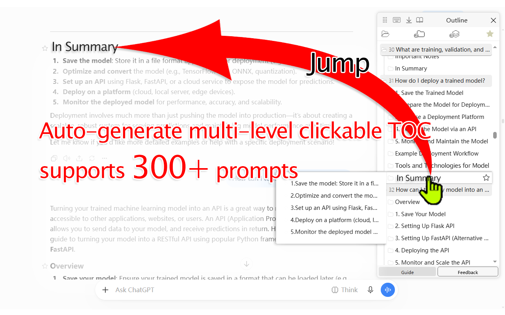
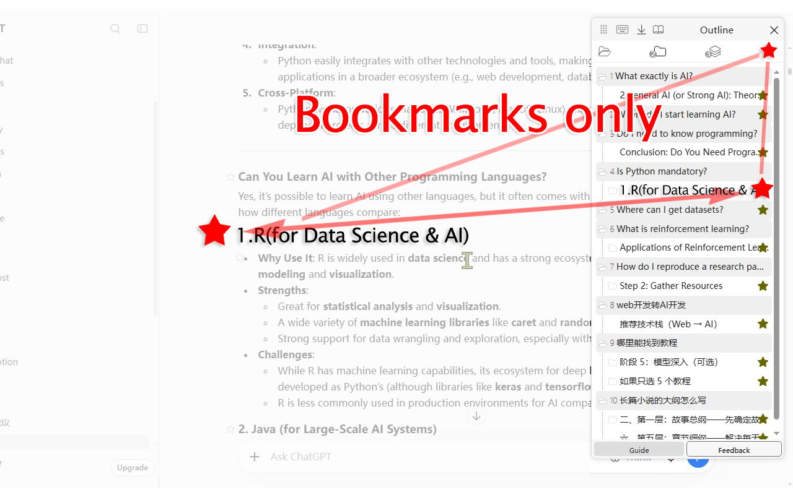
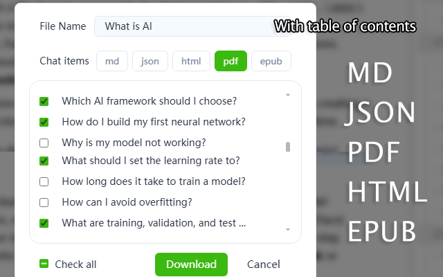
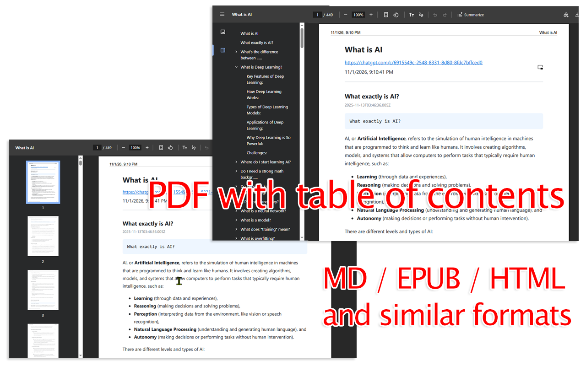
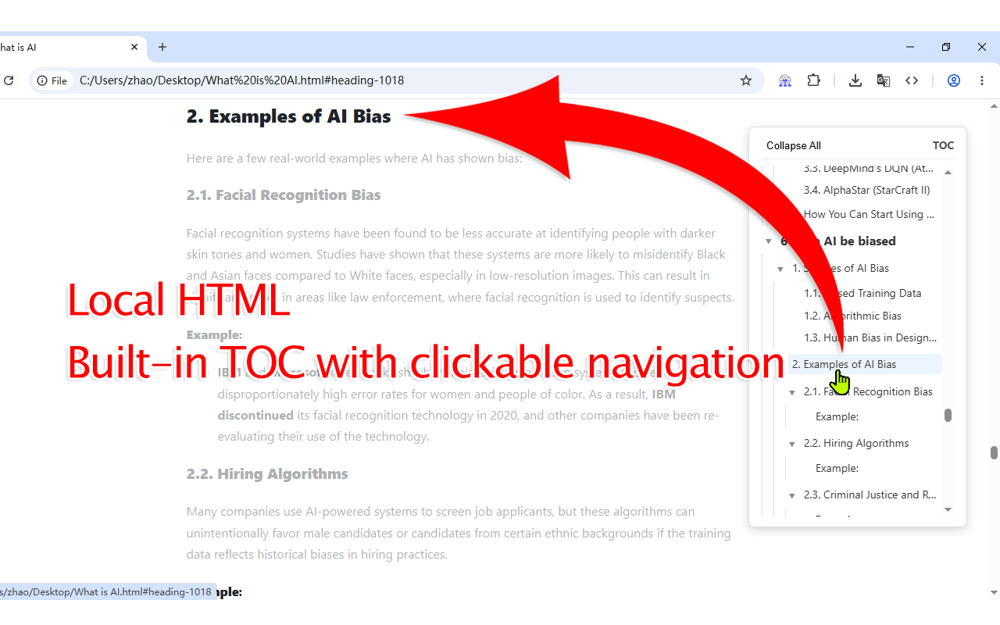

# Long ChatGPT Conversations(300+): Outline · Navigation · Bookmarks · Export — Open-Source Edition

English | [简体中文](README.zh-CN.md)

[](https://chromewebstore.google.com/detail/long-chatgpt-conversation/fklppbegohaleadmomfgjgpcighjheba)
[](https://chromewebstore.google.com/detail/long-chatgpt-conversation/fklppbegohaleadmomfgjgpcighjheba)
[](LICENSE)

An open-source, **backend-free** build of **Long ChatGPT Conversations** — an outline panel
that turns long AI chats into a clickable, navigable tree.

> **This repository contains the open-source edition — a separate build from the official
> Chrome Web Store release — published to promote the full version.**
>
> **Official release on the Chrome Web Store:**
> <https://chromewebstore.google.com/detail/long-chatgpt-conversation/fklppbegohaleadmomfgjgpcighjheba>
>
> The full version adds cloud bookmark sync, tags, a mind map, and other features. This
> open-source edition keeps the local outline, navigation, local bookmarks and export, and
> has **no backend, no account, and no tracking**.

## Project status and maintenance

> **⚠️ This open-source build may not be the latest version.**
>
> Maintaining an add-on that hooks into AI chat web pages is hard work: every platform
> changes its page structure frequently, and keeping up with all of them takes constant
> effort. The author has limited time to maintain this repository, so **this code is not
> actively maintained** and may lag behind platform updates.
>
> **The official Chrome Web Store release is always the latest working version and has the
> most complete feature set.** Its ChatGPT support in particular is the most complete, and
> it always gets the newest features first. Some new features may never be added here. If
> you just want to use the extension, install the official release:
> <https://chromewebstore.google.com/detail/long-chatgpt-conversation/fklppbegohaleadmomfgjgpcighjheba>

### Keeping this source build working

This extension works by reading each platform's page DOM. When a platform changes its HTML,
the first thing to check is the selectors in that platform's `js/<site>/treeCreator.js`.
In most cases, updating those selectors is enough. If the page structure changes
substantially, the HTML parsing logic in the same file may also need to be adjusted.

The fastest way to find the problem is to open the affected chat page, inspect its current
DOM in DevTools, and compare it with the selectors used in the source.

## FAQ

**Why is there no cloud sync or account?**
This edition has no server and no account system. Bookmarks and all other state are stored in
`chrome.storage.local` on the current browser profile, so they do not sync across devices.
Cloud bookmark sync is part of the official release.

**Why does the official release have more features?**
The official release adds cloud sync, tags, a mind map, and more export formats (HTML, JSON,
EPUB). This repository deliberately keeps only features that run entirely in the browser;
anything that needs a server or an account stays out.

**Why is ChatGPT support the most complete in the official release?**
ChatGPT changes its page structure more often than the other supported sites, so keeping it
working takes the most effort. New platform support and fixes go into the official release
first; this build may lag behind, or stop working until the selectors here are updated.

**Where are bookmarks stored? Is anything uploaded?**
Bookmarks are stored per conversation in `chrome.storage.local`, keyed by site and chat ID.
The extension makes no network requests: the only `fetch` calls load its own packaged HTML
files, and PDF export is generated locally. Clearing the extension's data or uninstalling
removes the bookmarks.

**A site stopped working. What should I do?**
In most cases the platform changed its DOM and the selectors need updating — see
[Keeping this source build working](#keeping-this-source-build-working). If you need a
working version right now, install the
[official release](https://chromewebstore.google.com/detail/long-chatgpt-conversation/fklppbegohaleadmomfgjgpcighjheba).

## Features

- **Outline tree** for long conversations — every prompt and every branch is a node.
- **Bookmarks** — star any outline node; stored locally per conversation. Toggle the star
  button in the panel header to show bookmarks only.
- **Jump** to any message with one click; live hover preview of the target message.
- **Fold / unfold** the tree or a subtree, with adjustable parse depth.
- **Search** inside the outline (`Ctrl+F`).
- **Fullscreen** a message, or a selected area of the page.
- **Export** a selection of messages to **PDF** or **Markdown** — generated locally.
- **Read mode**, keyboard shortcuts, draggable/resizable panel.
- All state is stored in `chrome.storage.local`; nothing leaves your browser.

## Screenshots

The images below are from the official build. The outline, jump and bookmark features
shown here are also available in this open-source edition.





The following screenshots show features exclusive to the official version — HTML / JSON /
EPUB export, and PDF with a clickable table of contents:







See the [official release](https://chromewebstore.google.com/detail/long-chatgpt-conversation/fklppbegohaleadmomfgjgpcighjheba) for these features.

## Supported sites

| Site | URL |
| --- | --- |
| ChatGPT | <https://chatgpt.com> |
| Gemini | <https://gemini.google.com> |
| DeepSeek | <https://chat.deepseek.com> |
| Doubao | <https://www.doubao.com> |
| Kimi | <https://www.kimi.com> |
| Qwen | <https://chat.qwen.ai> |
| Tencent Yuanbao | <https://yuanbao.tencent.com> |

## Install

### Chrome Web Store (official release)

[**Install Long ChatGPT Conversations**](https://chromewebstore.google.com/detail/long-chatgpt-conversation/fklppbegohaleadmomfgjgpcighjheba)

### From source (this open-source edition)

1. Download or clone this repository.
2. Open `chrome://extensions` and enable **Developer mode**.
3. Click **Load unpacked** and select this folder.
4. Open a supported chat page; the outline button appears on the right edge.

## Permissions

| Permission | Why |
| --- | --- |
| `storage` | Remember panel position, shortcuts, fold state, and bookmarks locally. |
| `debugger` | Render the current tab to PDF for local export. Only used when you click Export → PDF. |

Host permissions are limited to the supported chat sites listed above. There are no remote
requests: you can verify with the Network panel or by searching the source for `fetch(`.

## Project structure

```
manifest.json          Chrome MV3 manifest
js/background.js       Service worker: local PDF export + URL-change broadcast
js/tools.js            Shared helpers, i18n, dialogs
js/bookmarks.js        Local bookmark storage (chrome.storage.local)
js/content-base.js     Base class: observes the chat DOM
js/treeCreatorBase.js  Base class: builds the outline tree
js/articles.js         Collapse/expand the real chat articles
js/fullscreen.js       Fullscreen and area-capture helpers
js/navTree.js          Outline tree behavior
js/floater.js          Panel UI and bindings
js/<site>/             Per-site DOM adapters (treeCreator + content)
css/                   Shared and per-site styles
resources/             Injected HTML (panel, icons, dialogs)
_locales/              UI strings (en, zh_CN)
```

### Adding a site

Create `js/<site>/treeCreator.js` (DOM selectors and tree construction) and
`js/<site>/content.js` (entry point), then add a `content_scripts` block and the site's
origin to `host_permissions` and `web_accessible_resources` in `manifest.json`.

## License

[MIT](LICENSE). Third-party libraries and their licenses are listed in
[THIRD_PARTY_NOTICES.md](THIRD_PARTY_NOTICES.md).

## Disclaimer

This project is not affiliated with, endorsed by, or sponsored by OpenAI, Google, DeepSeek,
ByteDance, Moonshot AI, Alibaba, or Tencent. All product names and trademarks are the
property of their respective owners.
