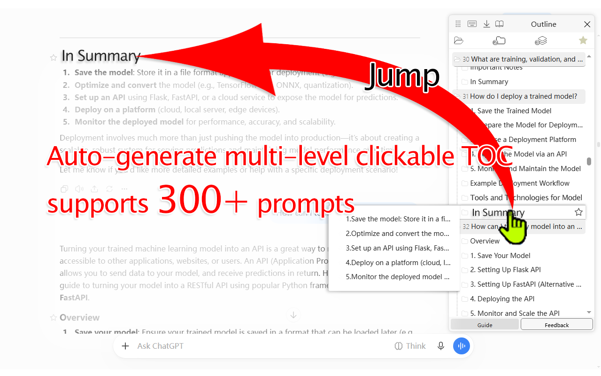
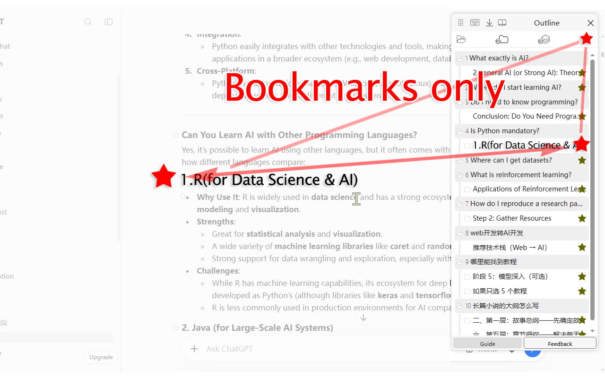
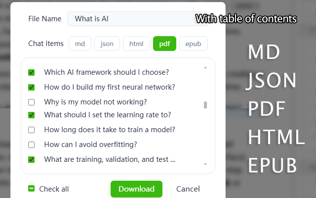
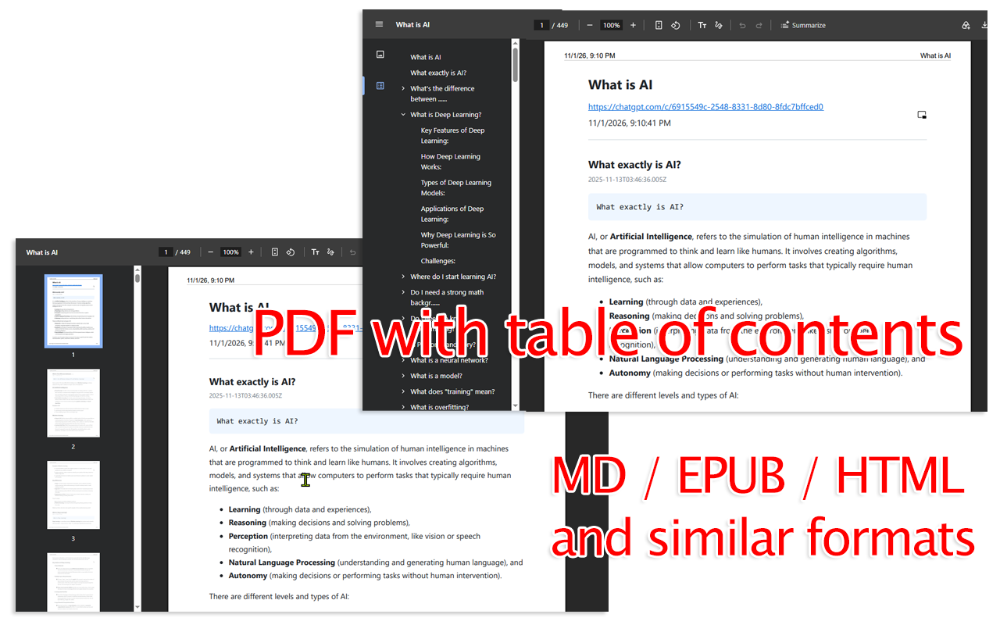
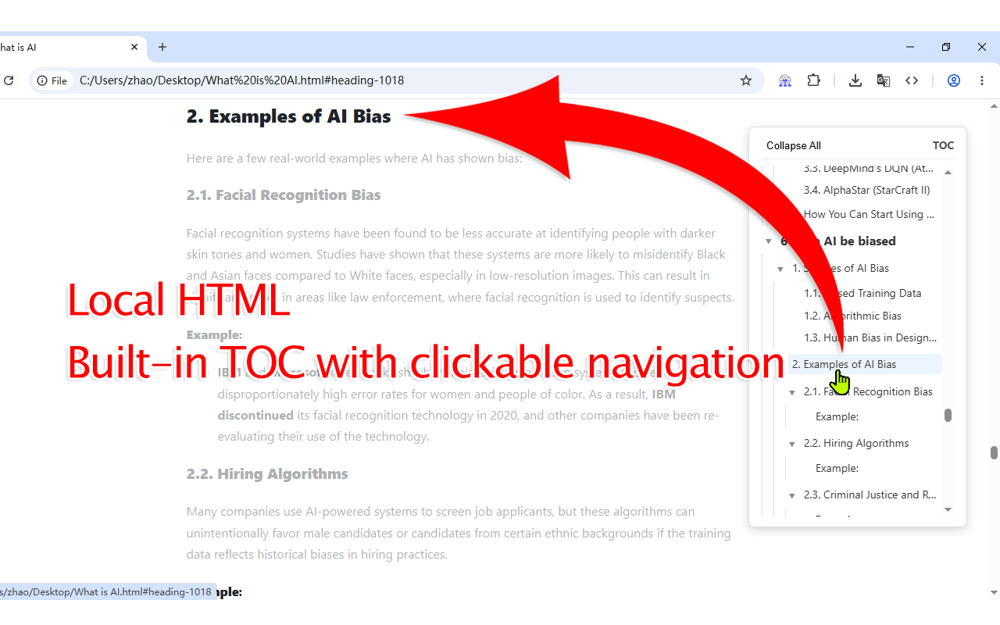

# Long ChatGPT Conversations(300+): Outline · Navigation · Bookmarks · Export — 开源版

[English](README.md) | 简体中文

[](https://chromewebstore.google.com/detail/long-chatgpt-conversation/fklppbegohaleadmomfgjgpcighjheba)
[](https://chromewebstore.google.com/detail/long-chatgpt-conversation/fklppbegohaleadmomfgjgpcighjheba)
[](LICENSE)

**Long ChatGPT Conversations** 的开源、**无后端**版本——把超长 AI 对话变成可点击、可导航的树状大纲面板。

> **本仓库是开源版，与 Chrome 应用商店的正式版是两个不同的构建，用于推广完整版。**
>
> **正式版（Chrome 应用商店）：**
> <https://chromewebstore.google.com/detail/long-chatgpt-conversation/fklppbegohaleadmomfgjgpcighjheba>
>
> 完整版额外提供云端书签同步、标签、思维导图等功能。开源版保留本地大纲、导航、本地书签和导出，**没有后端、无需账号、不做任何追踪**。

## 项目状态与维护

> **⚠️ 这个开源版本可能不是最新版。**
>
> 维护一个挂在 AI 对话网页上的外挂并不轻松：各平台的页面结构变化频繁，要持续跟进所有平台需要大量精力。作者没有足够时间维护本仓库，因此**这份代码并不处于积极维护状态**，可能落后于平台更新。
>
> **Chrome 应用商店的正式版永远是最新可用版，功能也最全。** 其中对 ChatGPT 的支持最完整，新功能也总是先在正式版上线。部分新功能可能永远不会出现在这里。如果你只是想使用插件，请安装正式版：
> <https://chromewebstore.google.com/detail/long-chatgpt-conversation/fklppbegohaleadmomfgjgpcighjheba>

### 如何让这份源码继续可用

本插件通过读取各平台页面的 DOM 工作。当某个平台改动 HTML 后，首先检查该平台 `js/<site>/treeCreator.js` 里的选择器；多数情况下，更新选择器即可修复。如果页面结构变化较大，同一文件里的 HTML 解析逻辑可能也需要调整。

最快的排查方式：打开出问题的对话页面，在 DevTools 里查看它当前的 DOM，再与源码里使用的选择器对照。

## 功能

- **大纲树**：每个提问、每个分支都是节点。
- **书签**：给任意大纲节点加星标，按会话保存在本地；点击面板顶部的星标按钮可只看书签。
- **跳转**：单击跳转到任意消息；悬停时实时预览目标消息。
- **折叠 / 展开**：可折叠整棵树或某个子树，解析深度可调。
- **搜索**：在大纲内搜索（`Ctrl+F`）。
- **全屏**：全屏查看某条消息，或框选页面区域放大。
- **导出**：把选中的消息导出为 **PDF** 或 **Markdown**，完全在本地生成。
- **阅读模式**、键盘快捷键、可拖动 / 可调整大小的面板。
- 所有状态都保存在 `chrome.storage.local`，不会离开你的浏览器。

## 截图

以下图片来自正式版。图中展示的大纲、跳转和书签功能，本开源版同样具备。





下面几张截图展示的是**仅正式版提供**的功能——HTML / JSON / EPUB 导出，以及带可点击目录的 PDF：







这些功能请安装[正式版](https://chromewebstore.google.com/detail/long-chatgpt-conversation/fklppbegohaleadmomfgjgpcighjheba)。

## 支持的平台

| 平台 | 网址 |
| --- | --- |
| ChatGPT | <https://chatgpt.com> |
| Gemini | <https://gemini.google.com> |
| DeepSeek | <https://chat.deepseek.com> |
| 豆包 | <https://www.doubao.com> |
| Kimi | <https://www.kimi.com> |
| 通义千问 | <https://chat.qwen.ai> |
| 腾讯元宝 | <https://yuanbao.tencent.com> |

## 安装

### Chrome 应用商店（正式版）

[**安装 Long ChatGPT Conversations**](https://chromewebstore.google.com/detail/long-chatgpt-conversation/fklppbegohaleadmomfgjgpcighjheba)

### 从源码安装（本开源版）

1. 下载或克隆本仓库。
2. 打开 `chrome://extensions`，启用**开发者模式**。
3. 点击**加载已解压的扩展程序**，选择本目录。
4. 打开任一支持的对话页面，右侧会出现大纲按钮。

## 权限

| 权限 | 用途 |
| --- | --- |
| `storage` | 在本地记住面板位置、快捷键、折叠状态和书签。 |
| `debugger` | 将当前标签页渲染为 PDF 以本地导出。仅在你点击「导出 → PDF」时使用。 |

主机权限仅限上表列出的对话站点。插件不会发起远程请求：可通过网络面板验证，或在源码中搜索 `fetch(`。

## 项目结构

```
manifest.json          Chrome MV3 清单
js/background.js       Service Worker：本地 PDF 导出 + URL 变化广播
js/tools.js            通用工具、i18n、弹窗
js/bookmarks.js        本地书签存储（chrome.storage.local）
js/content-base.js     基类：监听对话 DOM 变化
js/treeCreatorBase.js  基类：构建大纲树
js/articles.js         折叠 / 展开页面中的真实消息
js/fullscreen.js       全屏与区域截取辅助
js/navTree.js          大纲树交互
js/floater.js          面板 UI 与事件绑定
js/<site>/             各站点 DOM 适配器（treeCreator + content）
css/                   通用与各站点样式
resources/             注入的 HTML（面板、图标、弹窗）
_locales/              界面文案（en、zh_CN）
```

### 新增一个平台

创建 `js/<site>/treeCreator.js`（选择器与树的构建）和 `js/<site>/content.js`（入口），然后在 `manifest.json` 的 `content_scripts` 里加一个块，并把该站点的来源加入 `host_permissions` 和 `web_accessible_resources`。

## 许可证

[MIT](LICENSE)。第三方库及其许可证见 [THIRD_PARTY_NOTICES.md](THIRD_PARTY_NOTICES.md)。

## 免责声明

本项目与 OpenAI、Google、DeepSeek、字节跳动、月之暗面（Moonshot AI）、阿里巴巴、腾讯均无隶属、背书或赞助关系。所有产品名称与商标归各自所有者所有。
